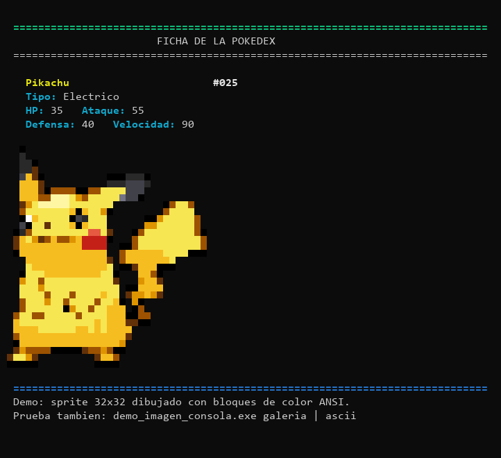
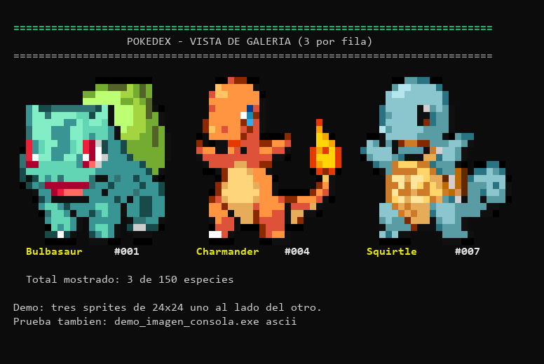

# Mostrar imágenes en la consola (investigación)

**Conclusión: sí se puede.** Una consola de texto no dibuja imágenes por sí sola,
pero se puede *simular* una imagen usando caracteres de bloque y color ANSI.
El resultado se ve pixelado, como un sprite de Game Boy, y funciona en la consola
normal de Windows 10/11 (Windows Terminal o `cmd.exe` moderno), sin librerías
gráficas ni ventanas.





## Cómo funciona

Cada celda de la consola es un rectángulo. El truco es usar el carácter Unicode
`▀` (media celda superior, U+2580):

- el **color del texto** pinta la mitad de arriba de la celda;
- el **color de fondo** pinta la mitad de abajo.

Así cada carácter muestra **dos píxeles verticales**. Una imagen de 32x32 píxeles
ocupa 32 columnas por 16 líneas de texto, y como la celda es aproximadamente el
doble de alta que de ancha, los píxeles quedan casi cuadrados.

Los colores se piden con ANSI de 24 bits:

```
\033[38;2;R;G;Bm   -> color del texto (píxel de arriba)
\033[48;2;R;G;Bm   -> color de fondo  (píxel de abajo)
```

Si los dos píxeles son iguales se usa un espacio con fondo de color (más corto),
y si los dos son transparentes se imprime un espacio normal.

## Archivos de esta carpeta

| Archivo | Qué hace |
|---|---|
| `convertir_sprite.py` | Convierte un PNG en un arreglo de C (`sprite_*.h`). Recorta el margen transparente y redimensiona con NEAREST para conservar el pixelado. |
| `sprite_pikachu.h`, `sprite_bulbasaur.h`, ... | Sprites ya convertidos (RGBA, 32x32 y 24x24). |
| `demo_imagen_consola.c` | Programa de prueba: ficha con imagen, galería de 3 y modo ASCII. |
| `vista_previa.py` | Convierte la salida ANSI en PNG (solo para revisar el resultado fuera de la consola). |
| `pikachu.png`, `1.png`, `4.png`, `7.png` | Sprites originales de PokeAPI usados como fuente. |

## Compilar y probar

```bash
gcc -Wall -Wextra -o demo_imagen_consola.exe demo_imagen_consola.c
demo_imagen_consola.exe            # ficha de Pikachu con imagen
demo_imagen_consola.exe galeria    # 3 Pokémon uno al lado del otro
demo_imagen_consola.exe ascii      # respaldo sin color
```

> **Importante en Windows:** hay que activar UTF-8 y las secuencias ANSI al
> arrancar el programa. Eso hace `preparar_consola()`:
>
> ```c
> SetConsoleOutputCP(CP_UTF8);
> SetConsoleMode(GetStdHandle(STD_OUTPUT_HANDLE),
>                modo | ENABLE_VIRTUAL_TERMINAL_PROCESSING);
> ```
>
> Sin eso, `▀` puede salir como basura y los `\033[...]` se ven como texto.
> En MinGW viejo hay que definir `ENABLE_VIRTUAL_TERMINAL_PROCESSING 0x0004`
> a mano (el header no la trae).

## Cómo integrarlo a la Pokédex del proyecto

La opción más simple y sin dependencias es **generar un header por sprite** y
guardar el arreglo en la estructura de la especie:

```c
/* funciones.h */
typedef struct {
    char ID[6];
    char Nombre[15];
    /* ... campos actuales ... */
    const unsigned char *sprite;   /* RGBA de 32x32, o NULL si no tiene */
    int lado_sprite;
} especies_pokemons;
```

Al llenar el vector (`llenar_vector_pokemon`) se asigna el sprite que
corresponda:

```c
vector[i].sprite = sprite_pikachu;
vector[i].lado_sprite = 32;
```

Y en `mostrar_estadisticas_pokemon` se llama a la función de dibujo:

```c
if (vector[indice].sprite != NULL) {
    imprimir_sprite_color(vector[indice].sprite,
                          vector[indice].lado_sprite, 32);
}
```

### ¿Y en la lista completa de 150?

No conviene: cada imagen ocupa al menos 12-16 líneas de alto y la tabla actual
tiene una línea por Pokémon. Meter una imagen por fila haría la lista
inmanejable (miles de líneas). Las opciones razonables son:

1. **Ficha individual** (la que ya existe): mostrar el sprite al consultar un
   Pokémon por ID o nombre. Es lo que hace la demo.
2. **Modo galería** paginado: 3-5 sprites por pantalla, con "ENTER para la
   siguiente página". Es lo que muestra `demo_imagen_consola.exe galeria`.
3. **Miniatura en la lista**: un sprite diminuto de 8x8 (4 líneas) por fila es
   técnicamente posible pero la tabla quedaría enorme y lenta; no lo recomiendo.

### Alternativas si no querés meter 150 arreglos en el código

- **Cargar PNG en ejecución** con `stb_image.h` (un solo header, dominio
  público): el programa lee `sprites/025.png`, lo escala y lo dibuja. Requiere
  que la carpeta `sprites/` viaje con el `.exe`.
- **Archivos binarios propios**: guardar cada sprite como `.rgb` (32*32*3
  bytes) y leerlo con `fread`. Más simple que un decodificador PNG.
- **ASCII art puro**: sin color, un texto por Pokémon. Es lo más portable
  (hasta una consola de 80x25 lo muestra), pero se pierde el color y el
  parecido. La demo incluye `ascii` como respaldo.
- **Sixel / iTerm2 / kitty**: protocolos de imagen reales, pero no funcionan
  en la consola estándar de Windows. Descartado para este proyecto.
- **Dibujar sobre la ventana de la consola con Win32/GDI**: posible pero frágil
  (la consola repinta y borra el dibujo) y depende de la ventana. No vale la
  pena para un trabajo práctico.

## Limitaciones a tener en cuenta

- **Tamaño de la salida:** una imagen de 32x32 genera ~1000 secuencias ANSI
  (unos 30-40 KB). Para una sola ficha no se nota; para 150 imágenes seguidas
  conviene paginar.
- **Velocidad:** imprimir con `printf` de a un píxel es aceptable, pero si se
  nota lento se puede armar la línea en un buffer y hacer un solo `printf`.
- **Redirección a archivo:** si se hace `programa.exe > salida.txt`, el archivo
  tendrá los códigos ANSI y no se verá la imagen. El modo ASCII es el respaldo.
- **Tipografía:** la consola debe usar una fuente monoespaciada que tenga el
  carácter `▀` (Consolas, Cascadia Mono, Lucida Console). Casi todas lo tienen.
- **Consolas viejas:** `cmd.exe` de Windows 7/8 no soporta color de 24 bits.
  En Windows 10/11 actualizado sí.
- **Salida estándar no interactiva** (por ejemplo, ejecutado desde un IDE que
  captura la salida): los códigos pueden verse como texto. Probar en Windows
  Terminal.
